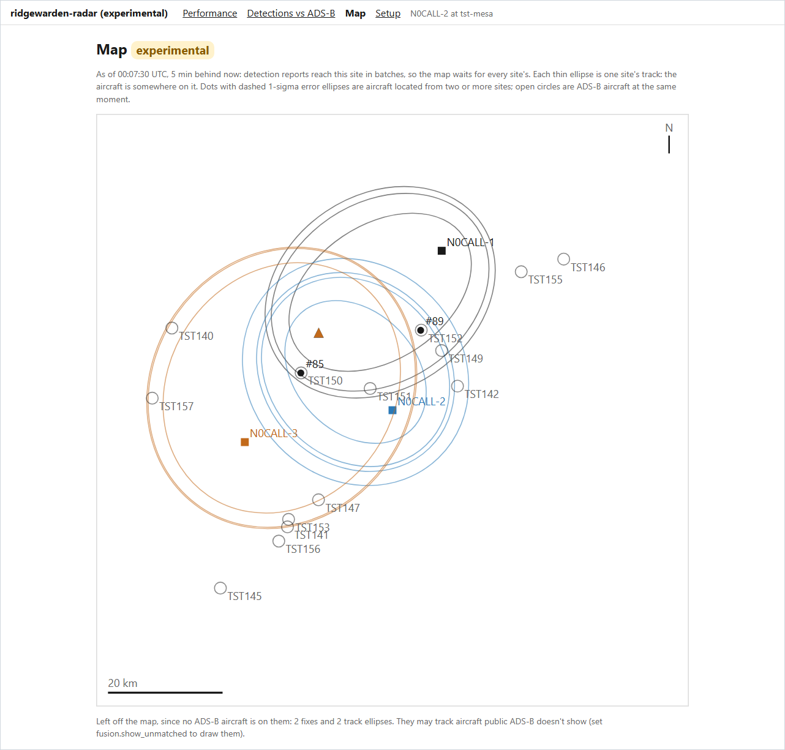
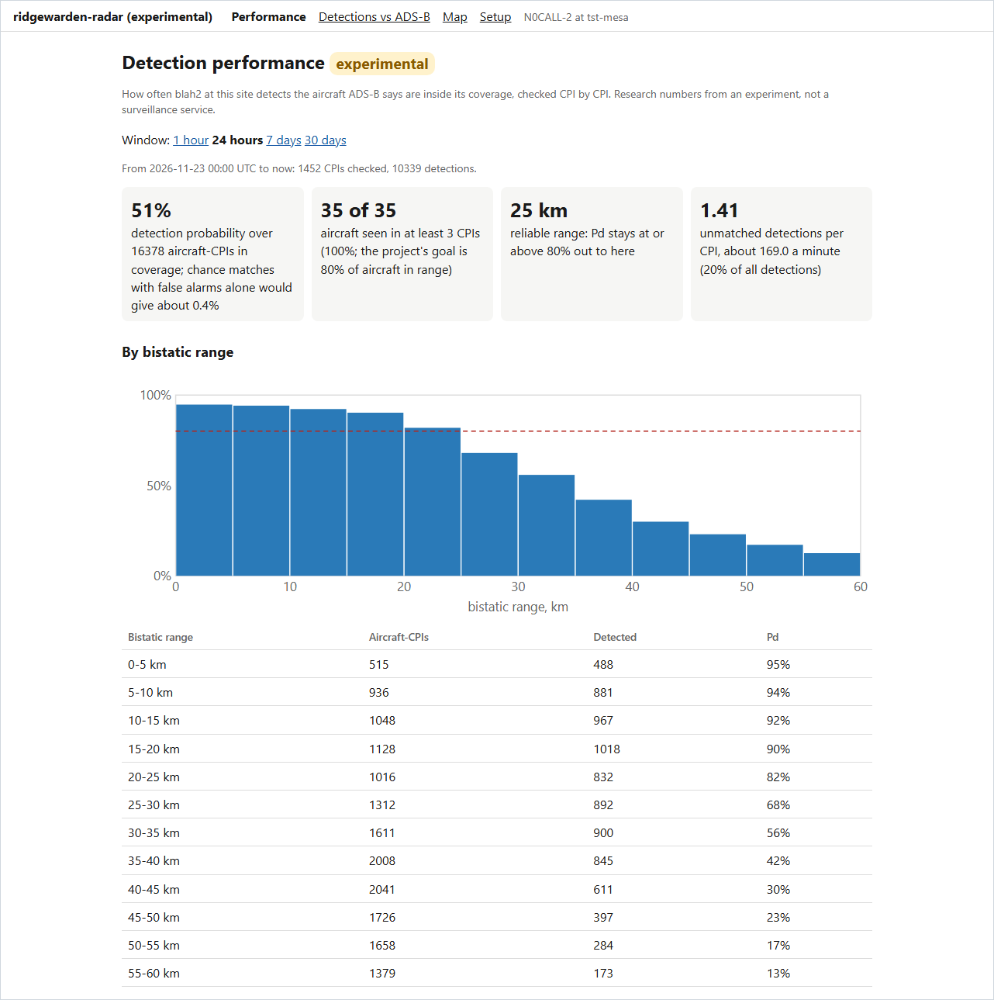
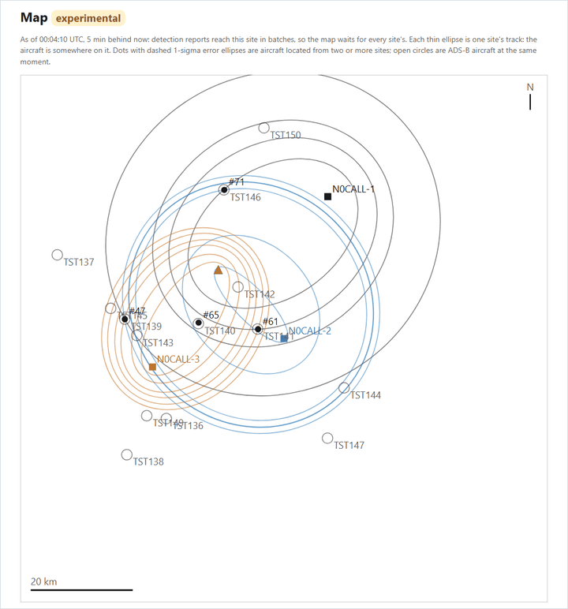
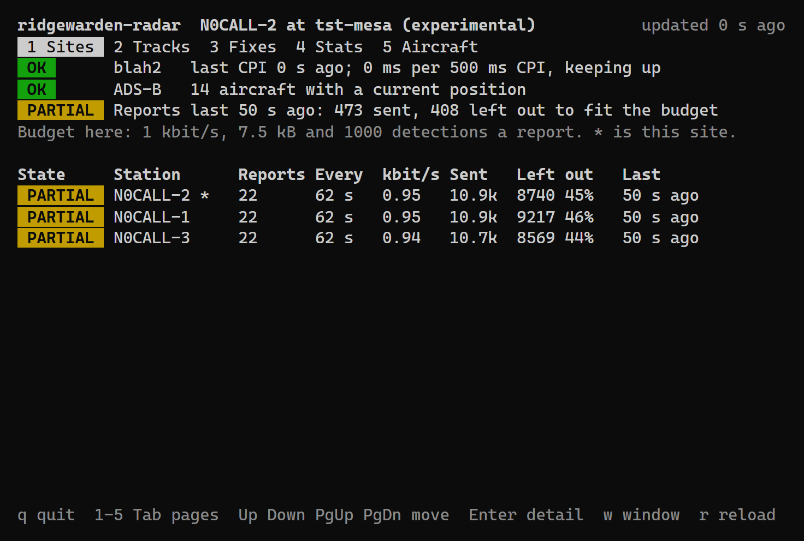

# ridgewarden-radar

**Experimental. How well does a passive radar at a mesh site really see aircraft, and can several sites find one without ADS-B?**

[](https://github.com/Londopy/ridgewarden-radar/actions/workflows/ci.yml)
[](https://github.com/Londopy/ridgewarden-radar/releases/latest)
[](https://github.com/Londopy/ridgewarden-radar/releases/latest)
[](https://github.com/Londopy/ridgewarden-radar/releases)
[](CHANGELOG.md)
[](LICENSE)

[](https://github.com/Londopy/ridgewarden-radar/commits/main)
[](https://github.com/Londopy/ridgewarden-radar/graphs/commit-activity)
[](https://github.com/Londopy/ridgewarden-radar/issues)
[](https://www.rust-lang.org)
[](#install)
[](https://github.com/Londopy/ridgewarden)

<picture>
  <source media="(prefers-color-scheme: dark)" srcset="docs/images/map-dark.png">
  
</picture>

<sub>The map on the simulator, three sites seeing the same synthetic aircraft. The station names are made up.</sub>

A ridgewarden app for AREDN meshes, and an experiment rather than a finished tool. A passive radar transmits nothing: it listens to an FM, DAB or TV transmitter and to that signal's echoes off aircraft. This app takes the detections [blah2](https://github.com/30hours/blah2) makes, checks every CPI against the aircraft a nearby ADS-B receiver reports and keeps an honest record of what the site detects, and with two or more sites on the mesh it works out where aircraft are from the sites' detections alone, then says how close that came to ADS-B.

> [!NOTE]
> It needs a [ridgewarden](https://github.com/Londopy/ridgewarden) core on the same box, which signs this site's detection reports and syncs everyone's between sites. Without a radio and blah2 it runs only against its own [simulator](#simulator). Spec sheet 10 of the AREDN app suite.

## Quick start

On a Linux box that already runs the [ridgewarden core](https://github.com/Londopy/ridgewarden):

```sh
curl -fsSL https://github.com/Londopy/ridgewarden-radar/releases/latest/download/install.sh | sudo sh
```

Once the core is set up the service starts, and the pages are on `http://<box>:8802/`. blah2 itself is installed separately, from its own repository (it runs in Docker).

💡 To watch this site from an SSH session, open the terminal view:

```sh
ridgewarden-radar top
```

It shows the feeds, the mesh's radar sites and their reports, the tracks and fixes, and the statistics, and reads them from the pages' own JSON, so it needs no sudo.

## What the pages show

<picture>
  <source media="(prefers-color-scheme: dark)" srcset="docs/images/performance-dark.png">
  
</picture>

<sub>The performance page on the simulator, about twelve minutes in. The station names are made up.</sub>

The performance page covers the last hour, day, week or 30 days: detection probability (Pd) by bistatic range bin and by aircraft, how many aircraft were matched in at least `detected_hits` CPIs (a low bar) against the 80% goal, unmatched detections per CPI and per minute, and the reliable range, the furthest range before Pd first drops below a threshold. Range bins and aircraft with too few CPIs in coverage are shown but not judged. Pd by hour of the day shows a transmitter that turns to talk or silence at certain hours as the programme, not the radar.

Unmatched detections are false alarms or aircraft without ADS-B, so the unmatched rate is an upper bound on false alarms. The other way round, a false alarm that lands inside an aircraft's gates counts as a hit; the page says how much Pd chance matches alone would give at the current false-alarm rate.



<sub>About four minutes of the map on the simulator, a moment every 10 seconds, sped up to under ten seconds. The station names are made up.</sub>

The map shows each site's transmitter and receiver, the ellipse of every confirmed track an ADS-B aircraft explains, the aircraft located from two or more sites with their error ellipses, and the ADS-B aircraft at the same moment. It runs `settle_s` behind live (see [how it works](#several-sites-tracking-without-ads-b)).

**Detections vs ADS-B** plots the last 1, 5 or 15 minutes in range and Doppler: each ADS-B aircraft's expected track, with blah2's detections on top, matched or not. **Setup** says in plain words how the radar works, the geometry and processing from blah2's config, whether blah2 keeps up with its CPI, the state of both feeds, and what goes over the mesh.

`/api/stats?window=24h` returns the statistics as JSON (listing the 50 aircraft with the most time in coverage, as the page does), `/api/map` the map's current moment, and `/api/setup` the setup page's facts: the feeds, this site's reports and every radar station heard on the mesh, with other stations' receivers rounded and transmitters only named, as the page shows them.

### In a terminal



<sub>The terminal view's Sites page, drawn by its test from what the app returned on the simulator. The station names are made up.</sub>

`ridgewarden-radar top` has five pages: **Sites** (this site's feeds, the warnings the pages show as banners, and each radar station's reports over 24 hours: how many, how often, their kbit/s, and the detections they carried and left out), **Tracks** (each site's confirmed tracks at the map's moment), **Fixes** (aircraft located from two or more sites, Enter for all of one), and **Stats** and **Aircraft** (the performance page's numbers, read only while one of them is open). Like the map, it counts tracks and fixes no ADS-B aircraft explains but lists them only with `fusion.show_unmatched = true`.

| | State | Feeds (terminal view) | A radar site's reports |
|:-:|---|---|---|
| 🟢 | **OK** | Answering, with current data | Arriving, every detection in them |
| 🟡 | **PARTIAL** | blah2 takes longer to process a CPI than to record one | Leaving their weakest detections out to fit the budget, or some can't be read here |
| 🔴 | **DOWN** | Not answering | None can be read here: another version's format |
| ⚪ | **STALE** | No new CPI for a minute, or no ADS-B as fresh as `max_age_s` | None for as long as the map waits (`settle_s`), or for three report intervals |

Range bins are OK at or above `pd_threshold` and PARTIAL below it; aircraft are OK once seen in `detected_hits` CPIs, and DOWN if they had enough CPIs in coverage but were seen in fewer than `detected_hits`. Neither gets a state with too few CPIs to judge.

## Features

- **Reads blah2 as it runs.** `/api/detection` (bistatic range in km, Doppler in Hz, SNR in dB, per CPI) every 250 ms, faster than its CPI, so none are missed, and `/api/config` for the transmitter and receiver positions, illuminator frequency, CPI and search area, so the two programs can't disagree about the geometry.
- **ADS-B as the truth.** It reads `aircraft.json` from the ADS-B receiver every second. For every CPI it moves each aircraft on to the CPI's time and works out its bistatic range (|Tx-P| + |P-Rx| - |Tx-Rx| on the WGS84 ellipsoid) and bistatic Doppler (from its ground speed, track and vertical rate, at the illuminator's wavelength). The definitions and sign match adsb2dd's, though adsb2dd differentiates successive positions instead of using the reported velocity.
- **Gated matching.** Detections match aircraft inside configurable range and Doppler gates, nearest pairs first, one detection per aircraft.
- **Counts only what can be judged.** An aircraft-CPI counts only when the aircraft was inside the area blah2 searches and outside its clutter notch, and only while the truth is current: the ADS-B list's own `now` must be within half of `max_age_s` of this box's clock (a dead receiver can leave its web server handing out the last file), and blah2's CPI timestamps must agree with it too. Otherwise every detection would look like a false alarm.
- **One setup at a time.** The statistics start again, from the next whole hour, whenever blah2's positions, frequency, CPI or search area change, so numbers from two setups never mix.
- **Tracks and locates aircraft without ADS-B** from every site's reports, on any site, and scores itself against ADS-B (see [several sites](#several-sites-tracking-without-ads-b)).
- **Fits a mesh budget.** Each site's detection reports average at most 1 kbit/s by default, signed events included, and say how many detections they left out.
- **Can hide aircraft ids.** `show_aircraft_ids = false` replaces callsigns and ICAO addresses with numbers on the pages and in `/api/stats`.
- **A terminal view** for a headless box, `ridgewarden-radar top`.

## How it works

blah2 does all of the signal processing: the cross-ambiguity function (CAF) between the reference and surveillance channels, clutter removal, and CFAR detection. This app starts from blah2's detections.

### What you need to make it real

| Part | What it takes |
|---|---|
| Receiver | A two-channel coherent receiver that blah2 supports: an SDRplay RSPduo or a KrakenSDR. |
| Antennas | Two: a Yagi on the transmitter for the reference channel, and one on the sky you want to watch for the surveillance channel, ideally shielded from the transmitter. |
| Computer | A mini PC or similar running blah2. Nobody has shown a Raspberry Pi 5 keeping up; the setup page tells you whether your box does. |
| ADS-B | A receiver on the same network (PiAware, dump1090-fa, or readsb with tar1090) for the truth feed. |
| Site | One that sees the transmitter well for the reference channel without the direct signal swamping the echoes. Siting decides most of the result, and talk radio or silence on the illuminator weakens detections. |

Without this hardware the app runs only against its simulator. Expect tens of kilometres at best from hobby hardware, and 1.5 to 3 km range resolution from FM.

### Several sites: tracking without ADS-B

blah2 lists a tracker as future work (its source has an early one, off by default), and earlier multi-site tools matched targets using ADS-B. This app does both parts itself, on every site's reports as they come through the mesh, so any site can act as the hub:

- **A tracker per site.** Each track is a Kalman filter on bistatic range and its rate (blah2's Doppler measures the rate, so one detection starts a track). Detections join tracks by gated nearest neighbour; a track is confirmed after 3 hits in its first 5 CPIs and ends after 6 misses in a row (all in `[tracker]`).
- **Fixes from two or more sites.** A confirmed track only says the aircraft is somewhere on an ellipse around that site's transmitter and receiver. For every pairing of tracks from different sites, a least-squares fit of position, velocity and height over the last minute of their detections finds where the ellipses meet and stay met; a third site's track is added when it fits too. The fit's covariance gives a 1-sigma error ellipse. The height starts from a typical cruising height with a wide allowance (`alt_m`, `alt_sigma_m`), so two-site fixes carry the height uncertainty in their ellipse and three sites pin it down.
- **Ghosts are counted, not hidden.** Two ellipses usually cross twice, and with two sites both crossings often fit about equally well; such fixes are dropped, since the data can't say which is right. Two sites' tracks of different aircraft can also fit one made-up aircraft well. Fits worse than about chance, needing more than 350 m/s, or with a 1-sigma ellipse longer than `max_error_km` are dropped too, but some ghosts remain, mostly with two sites. The performance page scores every fix against ADS-B, separately for two-site and three-site fixes: how many had an ADS-B aircraft within `truth_km`, and the median and 90% error among those (so they can't exceed `truth_km`).
- **Fused tracks.** Fixes are followed from one moment to the next, across gaps of up to a minute; the page counts fused tracks followed for a minute or more with at least three fixes made while ADS-B was current and no ADS-B aircraft near any of them. Those are the candidates for the spec's goal of an aircraft without ADS-B tracked from two or more sites, or long-lived ghosts.
- **The map** is inline SVG with a small script that refreshes it every 10 seconds (`/map.svg` is the map alone); without JavaScript the page reloads once a minute. Each moment is worked out `settle_s` after it (5 minutes by default, to allow for the report batch plus the core's sync interval), once every site's reports have arrived, so the map runs that far behind live. A moment is worked out once; reports that arrive later are not used for it.
- **Bounded work.** Each site offers at most 20 tracks (the longest) to the fit, reports are capped at 500 detections per CPI like blah2's own feed, and pairing stops after half of `every_s`, so a busy or misbehaving site can't stall the hub.
- **Each site logs its geometry** (from blah2's config) as a `radar.site` event in the core's main log, so the others can use its reports. Locating needs the sites' clocks to agree to well under a second: run NTP or GPS time on every blah2 box.

Fixes and confirmed tracks that no ADS-B aircraft explains may follow aircraft that public ADS-B doesn't show. They are counted on the pages but not drawn on the map, listed, or returned by `/api/map` unless `fusion.show_unmatched = true`. Even one site's track ellipses are hidden, since two sites' ellipses cross where the hidden fix would be. A track is explained when an ADS-B aircraft's bistatic range and Doppler for that site, at that moment, are within the match gates of the track's; while the ADS-B feed is down, nothing is.

### Over the mesh

Every minute (by default) the app sends that minute's detections through the core as one `radar.detections` telemetry event: the illuminator frequency, each CPI's time (so the tracker knows when a site looked and saw nothing), and each detection's bistatic range, Doppler and SNR as columns of whole numbers (10 m, 0.1 Hz and 1 dB steps). Detections, never signals: no samples, spectra or audio ever leave the box (Part 97.113(c)). The core prunes telemetry after 30 days. The setup page lists every trusted station whose reports reach this core, and their size as signed events.

Upgrade every site together. The report format changed after 0.1.0, and neither version can read the other's reports. This version still counts the ones it can't read, with no CPIs or detections, and the setup page names the station that sent them.

The spec gives the reports kilobits, so each site's reports average at most `max_kbps`, 1 kbit/s unless set otherwise: 7.5 kB a minute, counting the signature, keys and counters the core wraps around each report. Past that the weakest detections are left out, and the report says how many; the setup page shows how many detections this site's last report kept and left out, and the terminal view how many every station's reports left out. Measured on simulated sites, with the reports going through real cores:

| Simulated sky | Detections a minute, per site | What 1 kbit/s carried |
|---|---|---|
| The two-site example under [simulator](#simulator): 25 aircraft within 30 km, 0.5 s CPIs | 1,200 to 2,200 | About 500 of them, in 7.4 kB a minute |
| The simulator's defaults: 12 aircraft within 60 km, about 60 false alarms a minute | 56 to 444 over seven minutes, most at the start while its aircraft were still spread over the area | Every one, in 2.0 to 6.9 kB a minute |

A sky that busy loses most of its multi-site fixes. In simulated three-site runs, counting the fixes at one moment with every detection and then with the reports held to 1 kbit/s:

| Three simulated sites | Detections that fit | Fixes, every detection, then 1 kbit/s |
|---|---|---|
| 30 aircraft within 30 km | About a third | 13 to 5 in one run, 14 to 3 in another |
| 20 aircraft within 40 km | Half | 8 to 3 |
| 12 aircraft within 30 km | Four in five | The same |

Where the mesh has room, `max_kbps` goes up to 8.

Raw detections and expected aircraft positions are kept 15 minutes, and every site's reported detections two hours for the tracker. Multi-site fixes are kept a week. Hourly counts by range are kept 400 days. Hourly counts per aircraft, which carry the ICAO address and callsign from the ADS-B feed, are kept 31 days, just long enough for the 30-day window. Callsigns and addresses appear only as the ADS-B feed itself gives them.

## Install

The [quick start](#quick-start) script is the usual way in. Every [release](https://github.com/Londopy/ridgewarden-radar/releases/latest) has:

| Download | What it is |
|---|---|
| `install.sh` | The script from the quick start |
| `ridgewarden-radar_<version>_arm64.deb` / `_amd64.deb` | Debian / Raspberry Pi OS package with the systemd service. Install it with `sudo apt install ./ridgewarden-radar_<version>_arm64.deb` (`_amd64` on a PC). |
| `ridgewarden-radar-v<version>-<arch>-linux.tar.gz` | Static binary, service file, README and license |
| `<file>.torrent` and magnet QR codes | Each `.deb` and `.tar.gz` as a torrent, with its GitHub download as the web seed |
| `SHA256SUMS.txt` and `SHA256SUMS.txt.sig` | Checksums, signed with the release key |

The script and the `.deb` both write `/etc/ridgewarden/radar.toml` if it's missing and start the service once the core is set up. The pages are on port 8802. Only the script checks the download against the release key your core already trusts; the `.deb`'s own install script doesn't check the release signature. For a `.deb` you fetched yourself, put `SHA256SUMS.txt` and its `.sig` next to it and check it by hand: `sha256sum -c SHA256SUMS.txt --ignore-missing` checks the download, and `ridgewarden verify-release SHA256SUMS.txt` checks the release signature with the key your core already trusts.

The service runs as its own user, `ridgewarden-radar`, in the core's `ridgewarden` group, so it can sign events through the core but can't read the station's key. Its config is `root:ridgewarden-radar` with mode 0640, so run commands that read the config or touch the app's data as that user, which also keeps files owned right:

```sh
sudo -u ridgewarden-radar ridgewarden-radar --config /etc/ridgewarden/radar.toml <command>
```

`top` reads neither, so any user can run it.

## Usage

The installer does this for you. By hand:

```sh
ridgewarden-radar init --config /etc/ridgewarden/radar.toml
ridgewarden-radar run  --config /etc/ridgewarden/radar.toml
```

The pages are on `http://<box>:8802/`. Add them to the core's dashboard with an `[[app]]` entry in `ridgewarden.toml`.

### Watching from a terminal

```sh
ridgewarden-radar top                                    # this box's app, http://127.0.0.1:8802
ridgewarden-radar top --url http://n0call-pi.local.mesh:8802 --every 5
```

1 to 5 or Tab switch pages, Up and Down or PgUp and PgDn move through a list, Enter shows all about a site or a fix (Esc goes back), w steps the statistics window through an hour, 24 hours, 7 days and 30 days, r reads again, and q or Ctrl-C quits. It reads again every 2 s (`--every <seconds>`), keeps the last good read on screen, marked, if one fails, and says so plainly when it can't reach the app at all. It fits 80x24 and redraws when the terminal changes size. `NO_COLOR=1` turns colors off.

### Simulator

`simulate` stands in for both blah2 and the ADS-B receiver, so the whole app runs without hardware:

```sh
ridgewarden-radar simulate --listen 127.0.0.1:3000 --rx 39.50,-104.80,1650 --tx 39.62,-104.95,2100 --fc-mhz 96.9
```

It serves blah2's `/api/detection`, `/api/config`, `/api/timing` and `/api/timestamp`, and dump1090's `/data/aircraft.json`, in the same formats; its config is a shortened blah2 `config.yml`, and its timing has only the one stage a simulator has. Twelve synthetic aircraft (`--aircraft`) fly straight lines within `--radius-km` of the receivers; each CPI one is detected with a chance that falls off with bistatic range (`--r50-km`, where it is about half), with a little range and Doppler noise. There are random false alarms (`--false-per-cpi`) and two aircraft with no ADS-B (`--dark`).

For several sites, give `--listen` and `--rx` once per site (`--tx` and `--fc-mhz` once for all, or once each). Every site sees the same aircraft, so two ridgewarden cores, each with a radar app pointed at its own simulated site, exercise the whole multi-site path:

```sh
ridgewarden-radar simulate --listen 127.0.0.1:3000 --listen 127.0.0.1:3001 \
    --rx 39.50,-104.80,1650 --rx 39.75,-104.70,1600 --tx 39.62,-104.95,2100 --radius-km 30 --aircraft 25
```

Point the app at it:

```toml
[blah2]
url = "http://127.0.0.1:3000"

[adsb]
url = "http://127.0.0.1:3000/data/aircraft.json"
```

## Configuration

`/etc/ridgewarden/radar.toml` (`init` writes a commented one). The geometry, frequency and CPI are not in it; they come from blah2's `config.yml`.

```toml
[core]
url = "http://127.0.0.1:8790"
token_file = "/var/lib/ridgewarden/local.token"   # lets this app send detection reports

[blah2]
url = "http://127.0.0.1:3000"     # blah2's network.ports.api
poll_ms = 250

[adsb]
url = "http://piaware.local.mesh/skyaware/data/aircraft.json"   # tar1090: /tar1090/data/aircraft.json
poll_s = 1
max_age_s = 10                    # older ADS-B positions are not used

[match]
range_gate_km = 2.0
doppler_gate_hz = 8.0

[stats]
bin_km = 5
pd_threshold = 0.8                # reliable range: Pd at or above this
min_opportunities = 30            # CPIs in coverage before a bin or aircraft is judged
detected_hits = 3                 # matched CPIs before an aircraft counts as detected
show_aircraft_ids = true          # false: number the aircraft instead

[mesh]
enabled = true
batch_s = 60
max_kbps = 1                      # what the reports may average, signed events included
max_per_batch = 1000              # past either, the weakest detections are left out

[tracker]
confirm_m = 3                     # confirmed after 3 detections in its first 5 CPIs
confirm_n = 5
drop_after = 6                    # missed CPIs in a row that end a track
range_sigma_km = 0.3              # how far blah2's detections scatter
doppler_sigma_hz = 1.0

[fusion]
enabled = true
every_s = 10
settle_s = 300                    # above mesh.batch_s plus the core's sync interval
window_s = 60                     # seconds of each track one fix uses
alt_m = 6000                      # typical height, and its spread
alt_sigma_m = 3000
area_km = 100                     # search this far from this site's receiver
max_error_km = 5
truth_km = 3                      # a fix this close to an ADS-B aircraft is that aircraft
show_unmatched = false            # draw tracks and fixes no ADS-B aircraft explains
```

Both feeds are read over plain HTTP on the local network. Their addresses can't carry a user name or password, since the pages show them. The settings people change most:

| Setting | What it does |
|---|---|
| `match.range_gate_km`, `match.doppler_gate_hz` | How close a detection must be to where ADS-B puts an aircraft to be that aircraft |
| `mesh.max_kbps` | What this site's reports may average on the mesh, 1 to 8 kbit/s |
| `fusion.area_km` | How far from this site's receiver fixes are looked for, and how much the map shows |
| `fusion.show_unmatched` | Draw and list the tracks and fixes no ADS-B aircraft explains; they are counted either way |
| `stats.show_aircraft_ids` | Show ADS-B callsigns and addresses, or number the aircraft instead |

## Limits

> [!WARNING]
> Nothing here has run on real hardware: no RSPduo or KrakenSDR, no real blah2, no real ADS-B receiver, no second site. Everything is tested against blah2's and dump1090's output formats as their source writes them (see [building from source](#building-from-source)), the fixtures and the simulator. The detection statistics, tracking, multi-site fixes, bandwidth figures and pictures in this README are simulated; the numbers on a real site are what this experiment is for.

- **Two-site fixes can be ghosts**, and their height is weakly known; the page measures how often against ADS-B rather than claiming otherwise. Three sites are much better.
- **A busy sky loses detections at 1 kbit/s:** its weaker detections, and with them most of its multi-site fixes (see [over the mesh](#over-the-mesh)).
- **Straight and level.** The position fit assumes level, straight flight over its one-minute window, so climbing or turning aircraft come out a little off.
- **Siting can't be fixed in software:** the direct signal swamping echoes. Pd by range and by hour of the day show its effect.
- **No illuminator database.** The app uses whichever transmitter blah2 is set to. Which FM or ATSC transmitter gives the best geometry is the spec's open question, a siting job for the people running the site.

<details>
<summary><b>Not here:</b> the paper, the tracker upstream, ATSC</summary>

- The spec's write-up or paper with a faculty partner isn't software and isn't here.
- Contributing the tracker back to blah2 upstream is for the owner to offer; the tracker here is GPL-3.0 and lives in `src/track.rs`.
- ATSC TV illuminators: blah2 takes any frequency, so they work as far as blah2 and its sample rate allow; nothing ATSC-specific is done here.

</details>

## Building from source

This repo builds against the core's shared client crate, so check the core out next to it:

```sh
git clone https://github.com/Londopy/ridgewarden
git clone https://github.com/Londopy/ridgewarden-radar
cd ridgewarden-radar
cargo build --release
cargo test
```

The tests read fixtures in `fixtures/` laid out as the programs' source writes them, with made-up values. For blah2, at commit [c821bee](https://github.com/30hours/blah2/tree/c821bee3f0d27cf20c8447f3d908ef722905a4de): the detection JSON from `Detection::to_json` and `delay_bin_to_km` in `src/data/Detection.cpp`, the timing JSON from `Timing::to_json` in `src/data/meta/Timing.cpp` with each stage timed on its own as `src/blah2.cpp` does, and blah2's own `config/config.yml` as `api/server.js` serves it at `/api/config`. For ADS-B, `aircraft.json` as `generateAircraftJson` in dump1090-fa's `net_io.c` writes it, at commit [465e063](https://github.com/flightaware/dump1090/tree/465e06330372ab0586a6a5063c66b60a8750f2b6) (its `README-json.md` describes the fields); a test covers how readsb's `json_out.c` differs. The terminal view's tests read `fixtures/top-*.json`, what this app's own API returned on the simulator; `README_SHOTS=1 cargo test readme_shot` also writes their screens as HTML pages, from which the picture above is taken.

## Contributing

Issues and pull requests are welcome, especially from anyone running blah2 against real aircraft. See [CONTRIBUTING.md](CONTRIBUTING.md), and add a line under `Unreleased` in [CHANGELOG.md](CHANGELOG.md) for anything a user would notice.

## License

GPL-3.0-or-later. See [LICENSE](LICENSE).
